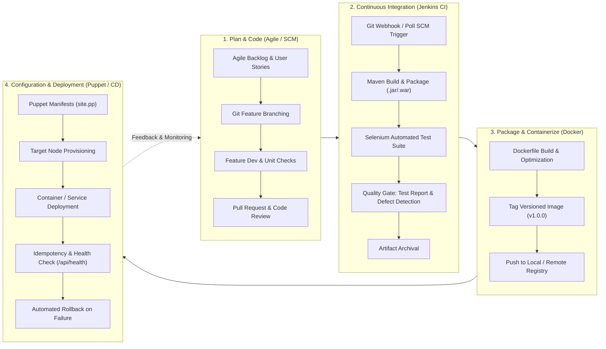

# Task 3: Agile Planning and DevOps Workflow
## Fitness Equipment Maintenance Portal

---

### 1. Agile User Stories & Acceptance Criteria

#### User Story US-01: Rapid Equipment Incident Reporting (Must Have)
* **User Story:** As a **Gym Floor Trainer / Staff**, I want to quickly report an equipment malfunction by entering the equipment ID, name, gym zone, issue description, and severity, so that the maintenance team is immediately alerted before members get injured.
* **Acceptance Criteria:**
  ```gherkin
  Scenario: Successfully log an incident
    Given the staff member is on the Incident Intake form
    When they submit an Equipment ID "TM-04", Name "Commercial Treadmill Pro", Zone "Cardio Deck", Issue "Drive belt slipping at >8km/h", Priority "High"
    Then a new maintenance record is generated with a unique Ticket ID (e.g., "TKT-1001")
    And the ticket status defaults to "Reported"
    And a confirmation badge with timestamp is displayed
  
  Scenario: Validation on empty required fields
    Given the user leaves Equipment ID or Issue Description blank
    When they click "Submit Maintenance Request"
    Then the submission is blocked and field-level validation errors highlight the missing inputs
  ```

#### User Story US-02: Search and Multi-Parameter Record Filtering (Must Have)
* **User Story:** As a **Facility Manager or Technician**, I want to search and filter maintenance records by Equipment ID, status, priority, or gym zone, so that I can immediately isolate critical issues and locate specific machines.
* **Acceptance Criteria:**
  ```gherkin
  Scenario: Filter records by status and priority
    Given the maintenance records table contains multiple tickets
    When the user selects Status "In Repair" and Priority "Critical"
    Then only tickets matching both filters are rendered
    And matching count indicator reflects the exact filtered subset
  ```

#### User Story US-03: Role-Based Ticket Lifecycle Transition (Must Have)
* **User Story:** As a **Maintenance Technician**, I want to advance a ticket from *Reported* to *In Repair*, *Awaiting Parts*, and *Resolved*, while logging technician notes and estimated parts cost, so that the team tracks work progression transparently.
* **Acceptance Criteria:**
  ```gherkin
  Scenario: Technician updates ticket to In Repair
    Given a ticket in "Reported" status
    When the technician assigns themselves "Alex Chen" and transitions status to "In Repair"
    Then the record status updates immediately to "In Repair"
    And the audit log appends the transition timestamp and assigned technician
  ```

#### User Story US-04: Executive Summary KPI Dashboard (Must Have)
* **User Story:** As a **Facility Operations Director**, I want to view an executive dashboard displaying Total Assets, Active Breakdowns, In-Progress Repairs, Resolved Tickets, and Zone-wise failure breakdown, so that I can make data-driven budget and equipment replacement decisions.
* **Acceptance Criteria:**
  ```gherkin
  Scenario: Dashboard KPI metric cards update dynamically
    Given active records exist in the database
    When a new ticket is logged or resolved
    Then the "Active Tickets", "Pending Repairs", and "Total Maintenance Spend ($)" counters update in real time without full page reload
  ```

#### User Story US-05: Infrastructure as Code & Automated CI/CD (Must Have)
* **User Story:** As a **DevOps Engineer**, I want the portal to build, test, containerize, and deploy automatically via Jenkins pipeline and Puppet configuration manifests, so that the staging and production environments remain drift-free and reproducible.
* **Acceptance Criteria:**
  ```gherkin
  Scenario: Git commit triggers continuous build and deployment
    Given a push to the develop or main branch
    When Jenkins triggers the pipeline
    Then code compiles via Maven, Selenium test suite runs, Docker container builds, and deployment succeeds with zero manual intervention
  ```

---

### 2. Product Backlog

| Backlog ID | Epic / Area | User Story / Task Title | Story Points | Priority (MoSCoW) | Target Sprint | DoD Status |
| :--- | :--- | :--- | :--- | :--- | :--- | :--- |
| **PB-01** | Core Portal | Equipment Incident Intake Form & Schema Validation | 3 | Must Have | Sprint 1 | Planned |
| **PB-02** | Core Portal | Records Registry Table with Live Status Indicators | 3 | Must Have | Sprint 1 | Planned |
| **PB-03** | Core Portal | Search, Category Filter & Keyword Indexing | 2 | Must Have | Sprint 2 | Planned |
| **PB-04** | Workflow | Role-Based Workflow Engine (Trainer, Tech, Admin) | 5 | Must Have | Sprint 2 | Planned |
| **PB-05** | Dashboard | Real-Time KPI Cards & Zone Equipment Breakdown Chart | 3 | Must Have | Sprint 2 | Planned |
| **PB-06** | REST API | REST Endpoints (`/api/records`, `/api/dashboard`, `/api/health`) | 3 | Must Have | Sprint 1 | Planned |
| **PB-07** | Git SCM | Repository Branching Structure (`main`, `develop`, `feature/*`) | 2 | Must Have | Sprint 1 | Planned |
| **PB-08** | Git SCM | Merge Conflict Simulation & Rebase Resolution Baseline | 3 | Should Have | Sprint 2 | Planned |
| **PB-09** | CI Pipeline | Jenkins CI Maven Build Job & Artifact Archive (.jar/.war) | 5 | Must Have | Sprint 2 | Planned |
| **PB-10** | Pipeline as Code | Declarative `Jenkinsfile` with Parametric Deployment | 5 | Must Have | Sprint 3 | Planned |
| **PB-11** | Quality Gate | Selenium WebDriver Automated Test Suite (4 Journeys) | 5 | Must Have | Sprint 3 | Planned |
| **PB-12** | Continuous Testing | Jenkins Test Report Publishing & Defect Injection Gate | 3 | Must Have | Sprint 3 | Planned |
| **PB-13** | Containers | Dockerfile Multi-Stage Packaging & Container Lifecycle Script | 5 | Must Have | Sprint 3 | Planned |
| **PB-14** | CD Pipeline | Automated Docker Registry Publish & Rolling Deployment | 5 | Must Have | Sprint 3 | Planned |
| **PB-15** | Provisioning | Puppet Configuration Manifests (`site.pp`), Idempotency & Rollback | 8 | Must Have | Sprint 3 | Planned |

---

### 3. 15-Task Kanban Board & Sprint Schedule

```
+----------------------------------------------------------------------------------------------------+
|                                    15-TASK KANBAN / SCRUM BOARD                                    |
+------------------------------------+-----------------------------------+---------------------------+
| TO DO (Backlog)                    | IN PROGRESS (Active Sprint)       | DONE (Verified & Tested)  |
+------------------------------------+-----------------------------------+---------------------------+
| Sprint 3 Tasks (T-10 to T-15)      | Sprint 2 Tasks (T-06 to T-09)     | Sprint 1 Tasks:           |
|  - T-10: Selenium E2E Automation   |  - T-06: Feature 1 Branch & PR    |  - T-01: Project Scope    |
|  - T-11: Jenkins Test Defect Gate  |  - T-07: MVP CRUD & Conflict Fix  |  - T-02: Problem Def      |
|  - T-12: Docker Container Build    |  - T-08: Jenkins CI Build Job     |  - T-03: Agile & DevOps   |
|  - T-13: Jenkins-Docker CD         |  - T-09: Jenkinsfile Pipeline     |  - T-04: Architecture     |
|  - T-14: Puppet Server Config      |                                   |  - T-05: Git Repo Init    |
|  - T-15: Provisioning & Rollback   |                                   |                           |
+------------------------------------+-----------------------------------+---------------------------+
```

#### Sprint Allocation Plan:
- **Sprint 1 (Days 1–5): Foundation & Architecture**
  - Scope: Tasks 1, 2, 3, 4, 5
  - Goal: Frozen scope, architecture design, Git repository, and core application baseline.
- **Sprint 2 (Days 6–10): Core MVP Features & Continuous Integration**
  - Scope: Tasks 6, 7, 8, 9
  - Goal: Branching workflow, feature completion, merge conflict resolution, Jenkins CI job, Jenkinsfile.
- **Sprint 3 (Days 11–15): Continuous Testing, Containerization & Puppet Provisioning**
  - Scope: Tasks 10, 11, 12, 13, 14, 15
  - Goal: Selenium test suites, Docker lifecycle, automated CD, Puppet provisioning manifests, idempotency, and rollback testing.

---

### 4. Definition of Done (DoD)

A user story or task is marked as **DONE** only when all following criteria are satisfied:
1. **Code Completeness:** Source code adheres to project standards, clean architecture, and modular structure.
2. **Review & Version Control:** Committed to a descriptive feature branch (`feature/<name>`), reviewed via simulated Pull Request, and cleanly merged into `develop`/`main` with tagged release version.
3. **Build Integrity:** Clean Maven build (`mvn clean compile package`) without errors or fatal warnings.
4. **Automated Testing:** Selenium test suite passes with generated test reports and failure screenshot handlers configured.
5. **Continuous Integration:** Jenkins pipeline stage completes with green build status and archived artifact.
6. **Container & Infrastructure Verification:** Docker container starts cleanly, health check endpoint (`/api/health`) responds HTTP 200, and Puppet/Ansible manifest executes idempotently.
7. **Documentation:** Deliverable markdown artifact updated with commands, logs, and verification proof.

---

### 5. DevOps Lifecycle Workflow Diagram


