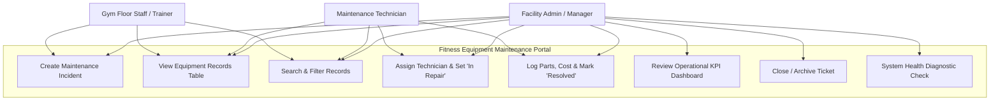

# Task 4: Requirements, Architecture, and Technology Setup
## Fitness Equipment Maintenance Portal

---

### 1. Software Requirements Specification (SRS) Summary

#### 1.1 Functional Requirements (FR)
- **FR-01: Incident Intake (Create Record):** The system must allow users to register maintenance requests with fields: `equipmentId`, `equipmentName`, `category` (Cardio, Strength, Free Weights, Functional), `zone` (Zone A - Cardio, Zone B - Strength, Zone C - Functional, Zone D - Recovery), `issueDescription`, `priority` (Low, Medium, High, Critical), `reportedBy`, and `estimatedCost`.
- **FR-02: Records Registry & Detail View:** The system must render all active records in an interactive table with visual badges for priority and status, formatted timestamps, and a detail drawer modal.
- **FR-03: Role-Based Status Workflow Engine:** The system must transition ticket status following a strict finite state machine:
  $$\text{Reported} \longrightarrow \text{Triaged} \longrightarrow \text{In Repair} \longrightarrow \text{Awaiting Parts} \longrightarrow \text{Resolved} \longrightarrow \text{Closed}$$
  - *Staff/Trainers* can create tickets and mark them *Reported*.
  - *Technicians* can transition to *In Repair*, *Awaiting Parts*, and *Resolved* with repair notes and cost.
  - *Facility Admins* can close, reopen, or delete tickets.
- **FR-04: Multi-Criteria Search & Filtering:** Users must be able to filter records dynamically by search keyword (equipment ID, name, or issue), status dropdown, priority dropdown, and gym zone.
- **FR-05: Executive Summary Dashboard:** The system must calculate and render real-time KPI metrics:
  - Total Equipment Logged
  - Open Issues (*Reported* + *Triaged*)
  - In-Progress Repairs (*In Repair* + *Awaiting Parts*)
  - Resolved & Closed Tickets
  - Critical Severity Alert Counter
  - Total Accumulated Maintenance Cost ($ USD)
  - Category breakdown distribution
- **FR-06: System Health Check & Diagnostics:** The application must expose `GET /api/health` returning system status, JVM memory usage, total records count, and server uptime.

#### 1.2 Non-Functional Requirements (NFR)
- **NFR-01: Performance:** API response latency under 150ms for local queries; page load under 1 second.
- **NFR-02: Portability:** Compatible with Java 17, 21, and 26; packaged via standard Maven 3.9+; executable on Windows, Linux, and Docker containers.
- **NFR-03: Zero External Database Overhead:** Portable JSON document datastore with thread-safe read/write locks, enabling instant local startup without configuring external database engines, while remaining production-upgradeable to PostgreSQL/MySQL.
- **NFR-04: Deployment Flexibility:** Runs standalone via executable JAR (`java -jar target/fitness-portal.jar`), deployable to Tomcat servlet container as WAR, or proxied behind Nginx.

---

### 2. Use-Case Diagram



---

### 3. Application Architecture Diagram

```mermaid
graph TB
    subgraph Client_Layer ["Presentation Tier (Web Browser / Mobile PWA)"]
        UI["Modern Responsive UI\n(Vanilla HTML5, Glassmorphism CSS3, Dynamic ES6 JS)"]
        Components["Dashboard KPI Cards | Incident Modal | Live Filter Table | Role Selector"]
        UI --- Components
    end

    subgraph Web_and_API_Layer ["Application & Service Tier (Java / Maven)"]
        Server["FitnessPortalServer (Java HTTP Engine)"]
        Router["REST Request Dispatcher & Static File Handler"]
        Controller["RecordsController & DashboardAnalyticsService"]
        Validation["Input Validator & Role-Based Access Guard"]
        
        Server --> Router
        Router --> Controller
        Controller --> Validation
    end

    subgraph Data_Layer ["Persistence Tier"]
        Store["MaintenanceRecordRepository"]
        JSONDB[("JSON File Datastore / Thread-Safe Memory Cache\n'data/maintenance_records.json'")]
        Store --- JSONDB
    end

    subgraph DevOps_and_Hosting ["Hosting & Infrastructure Tier"]
        Nginx["Nginx Reverse Proxy / Port 80"]
        Tomcat["Tomcat / Standalone Java Service :8080"]
        DockerHost["Docker Engine Container"]
        PuppetAgent["Puppet Managed Node (site.pp)"]
        
        Nginx -.-> Tomcat
        DockerHost -.-> Tomcat
        PuppetAgent -.-> DockerHost
    end

    Components <==>|HTTP / REST JSON (Fetch API)| Router
    Validation <==> Store
```

---

### 4. Data Model & REST API Specification

#### 4.1 Data Model Entity: `MaintenanceRecord`
```json
{
  "id": "TKT-1001",
  "equipmentId": "TM-01",
  "equipmentName": "Matrix Commercial Treadmill T7xe",
  "category": "Cardio",
  "zone": "Zone A - Cardio Deck",
  "issueDescription": "Belt slips intermittently at high speed; motor error code E-04",
  "priority": "High",
  "status": "In Repair",
  "reportedBy": "Marcus Vance (Floor Trainer)",
  "assignedTechnician": "Dave Miller (OEM Certified)",
  "resolutionNotes": "Replaced worn drive belt; tension calibrated to 120 lbs.",
  "estimatedCost": 280.00,
  "createdAt": "2026-10-17T10:30:00Z",
  "updatedAt": "2026-10-17T14:15:00Z"
}
```

#### 4.2 REST API Endpoints
| HTTP Method | Endpoint URI | Description | Request Body | Response Codes |
| :--- | :--- | :--- | :--- | :--- |
| `GET` | `/api/health` | System health check, uptime, memory, record count | None | `200 OK` |
| `GET` | `/api/records` | List all records (supports `?query=&status=&priority=&zone=`) | None | `200 OK` |
| `GET` | `/api/records/{id}` | Get single record details by Ticket ID | None | `200 OK`, `404 Not Found` |
| `POST` | `/api/records` | Create a new maintenance record | Record JSON | `201 Created`, `400 Bad Request` |
| `PUT` | `/api/records/{id}` | Update existing record, status transition, or notes | Updated JSON | `200 OK`, `404 Not Found` |
| `DELETE` | `/api/records/{id}` | Delete/archive maintenance record (Admin role) | None | `200 OK`, `404 Not Found` |
| `GET` | `/api/dashboard` | Aggregated KPI metrics and category breakdown | None | `200 OK` |
| `POST` | `/api/reset` | Reset database to initial seed data (testing utility) | None | `200 OK` |

---

### 5. Technology Stack Selection Justification

1. **Language & Runtime:** **Java (JDK 17/21/26)** — Enterprise standard, rock-solid thread safety, cross-platform compatibility, zero runtime licensing issues.
2. **Build Automation:** **Apache Maven (v3.9+)** — Standard lifecycle (`clean`, `compile`, `test`, `package`), standard directory layout (`src/main/java`, `src/main/resources`, `src/test/java`), seamless CI/CD integration with Jenkins.
3. **Database:** Thread-Safe In-Memory Document Store with auto-synced JSON persistence — lightweight, instant startup in containers and Puppet nodes with zero external DB dependencies, easily replaceable with PostgreSQL/MySQL in production.
4. **Web & UI Framework:** Modern HTML5, ES6 JavaScript, and Vanilla CSS with CSS custom properties (variables), glassmorphic dark theme, dynamic animations, and responsive mobile-first grid.
5. **Deployment Target:** Standalone Executable Fat JAR / Embedded HTTP Server on port 8080, compatible with Tomcat servlet deployment and Nginx reverse proxy.
6. **Automation & Testing:** Jenkins CI/CD pipeline, Selenium WebDriver test automation with Surefire reporting, Docker containerization, and Puppet manifest provisioning.
